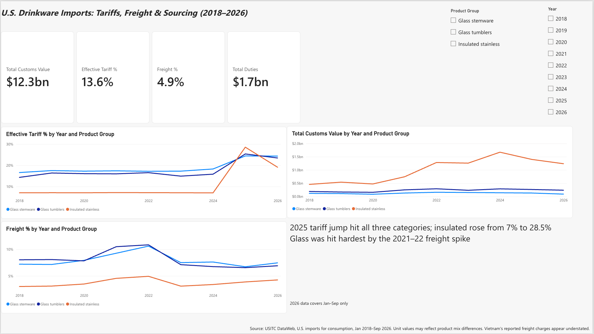
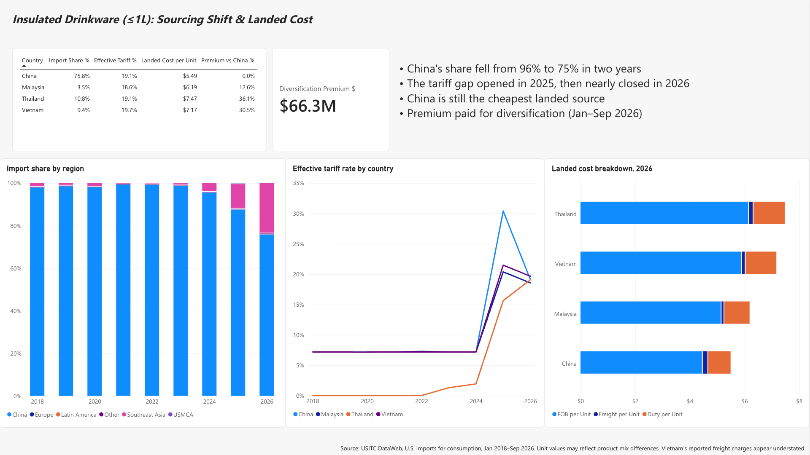
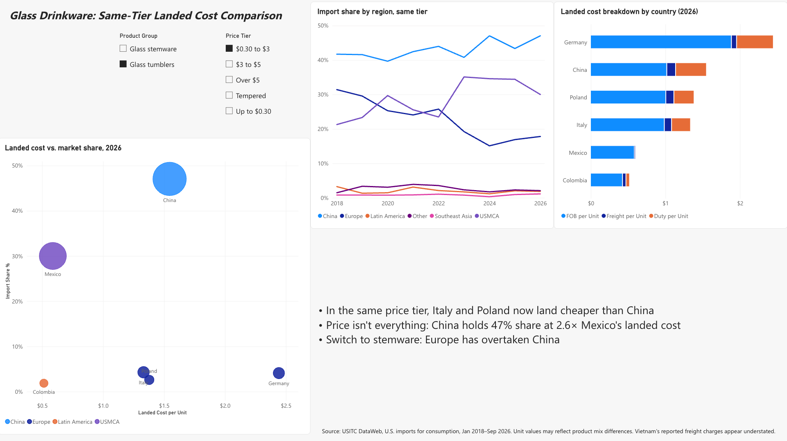

# Tariffs, Freight & Sourcing Shifts in U.S. Drinkware Imports (2018–2026)

An end-to-end sourcing analysis of U.S. imports of insulated stainless-steel drinkware and glass drinkware, built on official U.S. customs statistics. The project asks the questions a procurement team would ask after the 2025 tariff changes: *Did sourcing actually move away from China? Is moving cheaper? And where is the real cost opportunity?*

**Tools:** BigQuery (SQL) · Power BI (DAX) · USITC DataWeb



## Business questions

1. How did effective tariff rates and freight costs change by product category from 2018 to 2026?
2. Did import sourcing shift away from China, and when did the shift start?
3. After duty and freight, which country is actually the cheapest landed source?
4. How much are importers paying for diversification, and where is the cheapest alternative?
5. In glass, where lower-value, freight-heavy goods compete across many countries, does the picture look different?

## Data

| Item | Detail |
|---|---|
| Source | USITC DataWeb, U.S. imports for consumption |
| Period | Jan 2018 – Sep 2026, monthly |
| Granularity | HTS 10-digit code × country × month |
| Measures | Customs value, calculated duties, import charges (freight & insurance), first unit of quantity |
| Volume | ~135K raw records, 128 countries, 38 HTS-10 codes |
| In scope | Insulated stainless (HTS 9617.00.10, 9617.00.30), glass stemware (7013.28), glass drinking glasses (7013.37): 31 codes |

**Scope decision:** HTS 7323.93 (stainless household articles) was pulled but excluded. It is dominated by cookware and kitchenware, and the only code that could contain non-insulated steel cups (7323.93.0080) is ~$9.4B of mixed household goods with no way to isolate cups. Insulated steel beverage containers were reclassified by CBP from 7323.93.0080 (2% MFN) to 9617.00.10 (7.2% MFN), which also means classification itself drives landed cost.

## Method

- **Landed cost per unit** = (customs value + freight & insurance + duties) ÷ units
- **Effective tariff rate** = duties ÷ customs value, always computed as sum ÷ sum
- **Like-for-like comparisons:** insulated cost comparisons use a single HTS code (≤1L); glass comparisons stay inside one HTS price tier ($0.30–$3 per unit), so differences in product mix do not masquerade as price differences
- **Diversification premium** = Σ (country landed cost − China landed cost) × units, for non-China sources

## Key findings

### Insulated stainless drinkware (≤1L)

- **Imports more than tripled**, from $457M (2018) to $1.67B (2024), during the insulated-tumbler boom.
- **Tariffs barely touched the category until 2025.** The effective rate held at ~7% (the MFN rate) through 2024, jumped to 28.5% in 2025, and eased to 19.1% in 2026.
- **The shift away from China started before the tariff increase.** Vietnam and Thailand began gaining in 2024 at identical tariff rates. China's share fell from ~96% (2024) to ~75% (2026).
- **By 2026 the tariff gap had nearly closed**, with China, Vietnam, Thailand and Malaysia all at roughly 18.5–19.7%, yet the shift continued.
- **China is still the cheapest landed source.** Chinese FOB unit value fell 16% (from $5.27 to $4.44), more than offsetting higher duty, so China's landed cost actually *fell* from $5.83 to $5.49.

| Source (2026, ≤1L) | Landed cost / unit | vs. China |
|---|---|---|
| China | $5.49 | — |
| Malaysia | $6.19 | +12.6% |
| Vietnam | $7.17 | +30.5% |
| Thailand | $7.47 | +36.1% |

- **Importers paid a ~$66M diversification premium in Jan–Sep 2026** to source outside China. This is a resilience premium, not a cost saving.
- **Malaysia is the lowest-cost diversification option.** Sourcing Thailand's volume from Malaysia instead would have saved ~$22M over the same nine months, subject to supplier capacity and quality validation.

### Glass drinkware

- **Glass was tariffed earlier and harder.** China's effective rate on drinking glasses rose from 18.7% (2018) to 25.4% (2024) and 34.7% (2026); stemware reached 38.8%.
- **Europe overtook China in stemware.** Germany's share rose to 29.3% in 2026 while China fell to 24.3%.
- **Freight matters far more for glass.** Freight & insurance reached 10.5–10.9% of customs value during the 2021–22 container crisis, versus at most 4.9% for insulated steel, because glass is heavy, bulky and low in unit value.
- **Within the same price tier, Europe now lands cheaper than China.** Italy and Poland have nearly identical FOB prices to China (~$1.00), but lower duty makes them 11–14% cheaper landed.

| Drinking glasses, $0.30–$3 tier (2026) | Landed cost / unit |
|---|---|
| China | $1.55 |
| Poland | $1.38 |
| Italy | $1.33 |
| Mexico | $0.59 |

- **Price isn't everything.** Mexico (duty-free under USMCA, freight under 2% of value) lands at well under half of China's cost, yet China still holds ~47% of the tier versus ~30% for Mexico, which points to differences in assortment and capacity that customs data cannot show.

### Two sourcing stories

| | Insulated steel | Glass |
|---|---|---|
| Is moving out of China cheaper? | No. Diversification costs 13–36% more per unit. | Yes. Same-tier European sources are 11–14% cheaper. |
| Recommendation | Treat the premium as a resilience cost; prioritize Malaysia as the cheapest alternative. | Shift share toward European suppliers gradually; Mexico is the cost leader for basic glassware. |

## Data quality issues found and handled

| Issue | How it was handled |
|---|---|
| DataWeb export stacks the four measures as sections with repeated header rows | Allowed exactly 3 bad records on load (the three repeated headers) |
| Trailing comma on every exported line | Added a placeholder column to the load schema |
| `Total:` and blank rows in the export | Filtered out in SQL |
| HTS-10 codes split mid-period (e.g., 7013.28.2000 → .2010 / .2090) | Analyzed by product group and 8-digit price tier instead of 10-digit codes |
| Vietnam's reported freight was <0.1% of value in 2024 (vs ~4.5% for China) | Confirmed records exist every month (not missing), kept as reported and flagged; this understates Vietnam's landed cost, so premium estimates are conservative |
| A share calculation used `WHERE` before a window function, shrinking the denominator (China showed 52.4% instead of ~47%) | Caught by cross-checking SQL against the Power BI measure; fixed by computing shares in a CTE before filtering |

## Dashboard

Three-page Power BI report:

1. **Overview** – import value, effective tariff rate and freight share by product group, 2018–2026
2. **Insulated Sourcing** – regional share shift, tariff rate by country, landed-cost breakdown, diversification premium
3. **Glass Same-Tier** – landed cost vs. market share by country within a selected price tier, and regional share trends




## Repository structure

```
├── README.md
├── sql/
│   ├── 00_load_and_validate.sql       Load notes and data checks
│   ├── 01_build_cups_monthly.sql      Scope filter + pivot of the four measures
│   ├── 02_category_overview.sql       Value, tariff, freight, unit value by year
│   ├── 03_insulated_by_country.sql    Top sources and share shift
│   ├── 04_insulated_landed_cost.sql   Landed-cost comparison
│   ├── 05_diversification_premium.sql Premium paid vs. China
│   ├── 06_vietnam_freight_check.sql   Data quality investigation
│   ├── 07_glass_by_country.sql        Glass sources, tariffs, freight
│   ├── 08_glass_same_tier.sql         Same-tier landed-cost comparison
│   ├── 09_build_dashboard_table.sql   Region and price-tier mapping
│   └── 10_tier_check.sql              Validation of tier parsing
├── powerbi/
│   └── dax_measures.md                All measures and calculated columns
└── images/                            Dashboard screenshots
```

**SQL techniques used:** CTEs, conditional aggregation (pivot), window functions (`SUM OVER`, `MIN OVER`, `RANK`), `QUALIFY`, `SAFE_DIVIDE`, `CROSS JOIN` against a baseline, pattern-based classification with `CASE` / `LIKE`.

## Limitations

- **Country-level aggregates, not supplier quotes.** Unit values are averages across all importers and may reflect differences in product mix and quality, not only price.
- **Customs value approximates FOB.** Landed cost here excludes inland freight, brokerage, and inventory carrying cost.
- **Non-insulated steel cups are not covered**, since customs data has no cup-specific code for them.
- **2026 covers January–September only.**

## How to reproduce

1. In USITC DataWeb, query Imports for Consumption, HTS Items at HTS-10, monthly from 01/2018, all countries broken out, for HTS 9617, 732393, 701328 and 701337, with Customs Value, Calculated Duties, First Unit of Quantity and Import Charges.
2. Load the CSV into BigQuery as `trade.imports_raw` using the schema in `00_load_and_validate.sql`.
3. Run the SQL files in order. `09_build_dashboard_table.sql` produces the table used by Power BI.
4. Recreate the measures in `powerbi/dax_measures.md`.
## Author

**Qihong (Sicily) Li**
M.S. candidate, Northeastern University · Supply chain, procurement and analytics

[LinkedIn](https://www.linkedin.com/in/qihong-li-pm/)
